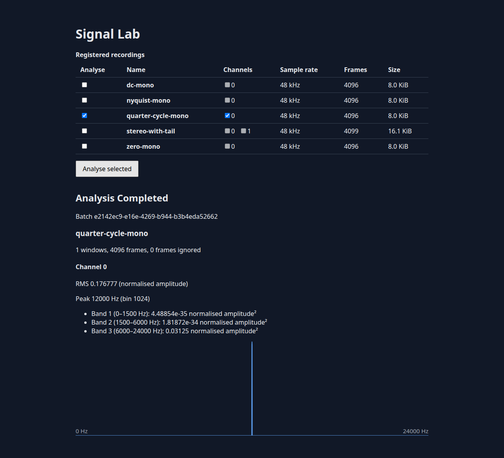

# Signal Lab

> **Technology demonstration.** Signal Lab is not a production architecture or a system designed for a client. Its brief is to show how Java, Rust, Python and three UI frameworks can work together on a distributed workload where performance matters. The service boundaries make the integration between the technologies visible. A production design would start with an analysis of the client's needs and a concrete set of requirements for workload, latency, reliability, security, deployment and operating cost.

Signal Lab analyzes synthetic PCM recordings and shows RMS, spectrum, peak and band powers in React, Angular and React Native clients. A Java/Spring service coordinates a Rust compute engine and a Python/FastAPI recording catalogue, with PostgreSQL for persistence and RabbitMQ for job delivery.

## Getting started

The commands below target a Linux host with Docker Engine and the Compose plugin. The Docker daemon must be running and accessible to your user. Install Git, Node.js 24 with npm 11, JDK 25 with Maven 3.9, Rust/Cargo 1.91 with rustfmt and Clippy, and uv 0.8.15. Check that `mvn --version` reports Java 25. The first setup and build need network access to download dependencies and base images.

From a fresh checkout:

```sh
git clone https://github.com/DrTtnk/signal-lab-demo.git
cd signal-lab-demo
npm ci
npm run setup
cp .env.example .env
npm run fixtures
docker/build.sh
docker compose --env-file .env -f docker/compose.yaml up --no-build --wait -d
```

Open [http://127.0.0.1:4173](http://127.0.0.1:4173), select a recording and one or more channels, then submit an analysis. The fixture command generates the recordings locally. The sample credentials are for local use. Keep your existing `.env` on subsequent runs. If port 4173 is already in use, change `WEB_PORT` in `.env` and open the corresponding URL.

The same stack serves three clients. Each uses the same recording catalogue and analysis API.

| Client | URL |
| --- | --- |
| React | [localhost:4173](http://127.0.0.1:4173/) |
| Angular | [localhost:4173/angular/](http://127.0.0.1:4173/angular/) |
| React Native (Expo web) | [localhost:4173/native/](http://127.0.0.1:4173/native/) |

To open the native client in an Android emulator, start the Compose stack, run `adb reverse tcp:4173 tcp:4173`, then run:

```sh
EXPO_PUBLIC_API_ORIGIN=http://127.0.0.1:4173 npm run start --workspace @signal-lab/native -- --android
```

Use the corresponding `WEB_PORT` if you changed it. A physical device needs an API origin that it can reach. The default Compose binding is loopback.



See the [functional design](docs/FD.md), [shared contracts](docs/contracts.md), [numerical profile](docs/numerics.md) and [acceptance status](docs/AC.md).

## How to run tests

After setup, keep Docker running. The browser suite uses Playwright Chromium. On a Linux host that lacks Chromium system libraries, install them first with `npx playwright install-deps chromium`.

```sh
npm run check
npm run setup:browser  # once per Playwright version
npm run e2e
```

- `check` runs static checks, unit and integration tests, an independent SciPy comparison, the three client builds and untimed Rust benchmark smoke tests.
- `e2e` builds and starts its own Compose stack on port 4175. It exercises all three browser clients, service outages and restart, then removes its test volumes. The demo can stay running on port 4173. See the [E2E guide](docs/e2e.md).
- Numerical tests cover seeded inputs and bit-identical results with 1, 2 and 4 workers. Service tests use real PostgreSQL, RabbitMQ and Rust execution where applicable.

Run checks and builds in sequence because they share output files. To rerun checks without the Turborepo cache, use `npm run check -- --force --concurrency=2`. Use an idle machine for timed benchmarks. See the [commands, results and measurement limits](docs/benchmarks.md).

## How to build and deploy locally

`npm run build` builds local artifacts. `docker/build.sh` builds the three application images using host networking.

To stop the Compose demo and keep its data:

```sh
docker compose --env-file .env -f docker/compose.yaml down
```

For the optional Kubernetes demo, install Minikube, kubectl, Helm and curl. After the setup and image build above, run `deploy/minikube.sh up`. The script uses the Docker driver and allocates 4 CPUs and 6 GB of memory. Run `deploy/minikube.sh e2e` after installing Playwright Chromium to test the browser flow through a temporary port-forward on port 4174. The script keeps its kubeconfig at `.kube/config`. Use `deploy/minikube.sh stop` to stop the cluster or `deploy/minikube.sh down` to delete it.
